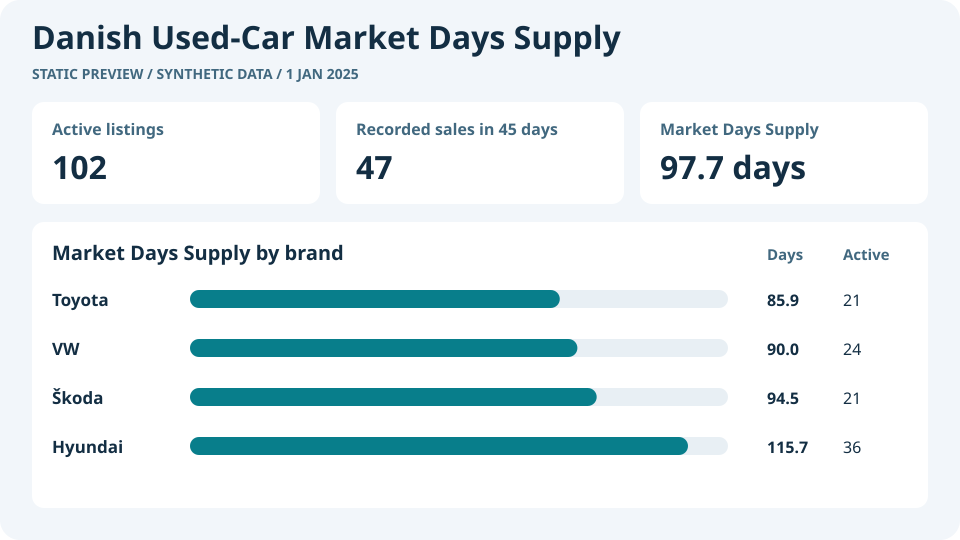

# Danish Used-Car Market Days Supply

**For each used-car brand and model in Denmark, how many days would the stock in the latest snapshot last at the recorded sales pace of the previous 45 days?**

I worked with real Danish used-car listing data. I used Python to count active listings and recent recorded sales from monthly snapshots, checked the Market Days Supply calculation in SQLite, and built a Power BI dashboard to compare brands and models.

I can't share the original automotive data publicly, so I used synthetic listings for the GitHub demo. They let you run the same workflow with fictional vehicle records.

## How I approached the problem

1. **I chose Market Days Supply** because it compares how many cars are for sale with how quickly similar cars have been selling. I divide active listings by the average daily sales pace over the preceding 45 days. [Market Days Supply methodology](https://docs.marketcheck.com/docs/api/cars/market-insights/market-days-supply)
2. **I checked what each row represented.** The same car could appear as sold in more than one monthly snapshot. I counted distinct cars marked `forsale = 1` on the latest snapshot and counted each car marked `sold = 1` with a recorded exit in the preceding 45 days once. When a car had several qualifying records, I kept its latest qualifying exit. I used the newer export when two rows represented the same car and snapshot. Recorded listing exits serve as a proxy for sales.
3. **I checked the calculation before using it in the report.** I compared the Python and SQLite results overall, by brand, and by model within brand. If a group has zero recorded sales, I leave Market Days Supply blank because the data gives me no recent sales pace to divide by.

## Skills I can apply to other projects

- **Defining a business metric.** I turned a stocking question into a measure with a clear reporting date and sales window. In a purchasing or replenishment project, I could compare days of supply with supplier lead times to identify products that may need reordering.
- **Preparing and validating data.** I worked out which records represented the same car and checked the results in Python and SQL. I can use the same approach to define what counts as one observation in inventory snapshots, sales transactions, or customer histories.
- **Modeling data for decisions.** I set up Power BI measures and filters to compare groups. The same approach could support category comparisons, flag slow stock for pricing review, or show how much cash is tied up in inventory when unit costs are available.

## How it works




## Run the demo

From the project folder, use a Python environment with pandas. The dependency is listed in `requirements.txt`. SQLite is included with Python.

```sh
python build_market_snapshot.py data/demo_snapshots.csv --output output/demo_market_snapshot.csv
python validate_market_days_supply.py output/demo_market_snapshot.csv
python -m unittest discover -s tests -v
```

The synthetic snapshot dated **1 January 2025** has **102 active listings** and **47 vehicles recorded as sold** over the previous 45 days, giving **97.7 days of supply**. The validator also accepts the report filters as command-line arguments.

## Power BI

Open `power-bi/DanishUsedCarDemand.pbip` in Power BI Desktop on Windows and select **Refresh** to load the embedded synthetic dataset. The measures recalculate both counts and MDS for the current selection. [Power BI project](power-bi/DanishUsedCarDemand.pbip) · [Report guide](power-bi/report.md) · [DAX measures](power-bi/measures.dax)

The automated checks verify the embedded data, model field bindings, and configured slicers. Rendering and interaction checks in Power BI Desktop are pending.
